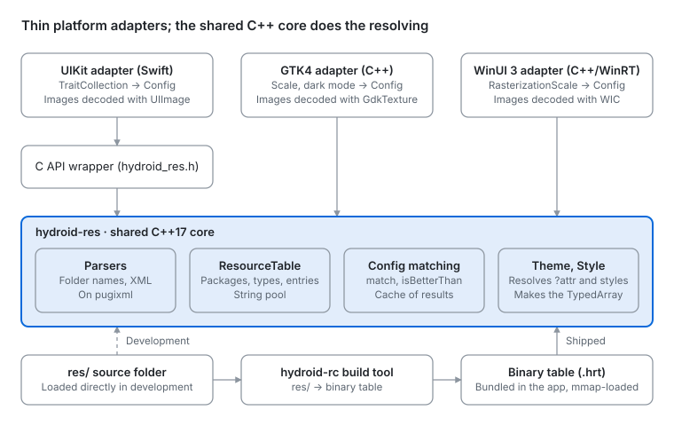

# Hydroid resource system: design and development roadmap

Nov 14, 2026 · @fmthead

## Overview

The resource layer is one shared C++17 library, `hydroid-res`, and UIKit, GTK4 and WinUI 3 each get only a thin adapter that passes it the current state of the device. For the same `res/` folder and the same device state, all three platforms must pick exactly the values Android picks.

- **Targets:** iOS (UIKit, Swift), Linux (GTK4, C++), Windows (WinUI 3, C++/WinRT)
- **Input:** an Android source `res/` folder. Reading a compiled APK (`resources.arsc`, binary XML) is out of scope, to be added later.
- **Included:** the resource table, qualifier matching, resolving references, themes and styles, and the layout and drawable XML trees an inflater uses
- **Excluded:** creating and drawing views, running animations. The resource layer only returns values.
- **Dependencies:** one XML parser, pugixml. Decoding images is left to each platform's API.

## Modules



The GTK4 and WinUI 3 adapters call the C++ core directly, and Swift goes through a stable C API wrapper. During development the core reads `res/` directly; when shipped, it reads a binary table that `hydroid-rc` made beforehand.

## Resource table data structures

The table has the structure of Android's `resources.arsc`: three levels, package → type → entry, and each entry holds a list of candidate values, one per set of qualifiers. Ids use Android's `0xPPTTEEEE` form too, so they can be compared directly with aapt2's output when debugging.

- **Package ids:** the framework (`android`) is `0x01` and an app is `0x7f`. Libraries such as AppCompat can be added as packages of their own. A resource of another package is named `@package:type/name` and looked up by name in the packages loaded before (the `-I` of aapt2 link). Only what that package opened with `<public>` can be named so; the rest only through a private reference such as `@*`. Before the framework is bundled (step 6), an `@android:` reference in values is the error "no package 'android' is loaded" (the `android:` attributes of XML files, and the @android: references in their values, are left alone).
- **Type and entry ids:** assigned as aapt2 assigns them. An id given by `<public id="">` is kept, type id included. The other types take the lowest type ids left, from 1, in the order of `ResType` (anim, animator, array, attr, …). Only the types that exist take one, and styleable, which does not exist at runtime, takes one too. The other entries take the lowest entry ids left within their type, from 0, in the byte order of their names. The same input always gives the same ids.
- **Lookup by name:** an inflater looks resources up by name, as in `@string/title`, so there is a hash map of `"package:type/name" → ResId`.

```cpp
using ResId = uint32_t;              // 0xPPTTEEEE

enum class ValueKind : uint8_t {
  Null, Empty,                       // @null, @empty
  Id,                                // an id resource: <id name="..."/>, @+id/...
  Reference, AttrRef,                // @type/name, ?attr/name
  String, StyledString,              // a string with markup such as <b> has a list of spans
  Color, Dimension, Fraction, Float, Int, Bool,
  File,                              // a file such as layout/foo.xml, drawable/bg.png
  Style, Array, Plurals, AttrDecl, StyleableDecl
};

// Made only by the factories (Value::color, Value::string, ...); the accessors check the kind
class Value {
 public:
  ValueKind kind() const;
  ResId    ref() const;              // Reference, AttrRef
  uint32_t argb() const;             // Color
  int32_t  intValue() const;         // Int
  uint32_t complexData() const;      // Dimension, Fraction (as in Res_value)
  uint32_t index() const;            // place in a pool: String, File, Style, Array, ...
  // ...
};

struct Candidate { Config config; Value value; };  // Config is the next section

struct Entry {
  uint16_t id;                       // entry id
  std::string name;
  bool isPublic;                     // <public>
  std::vector<Candidate> candidates; // one per configuration, in compareConfigs order
};

struct TypeTable { ResType type; uint8_t id; std::vector<Entry> entries; };

struct Package {
  uint8_t id; std::string name;
  std::vector<TypeTable> types;
  // One pool per kind of value. Value::index() is a place in it
  std::vector<std::string> strings;
  std::vector<StyledString> styledStrings;
  std::vector<FileRef> files;
  std::vector<Style> styles;
  std::vector<Array> arrays;
  std::vector<Plurals> plurals;
  std::vector<AttrDecl> attrs;
  std::vector<StyleableDecl> styleables;
};
```

Strings and compound values are kept in the pools of the `Package`, one per kind of value, and `Value::index()` points into them.

| Kind | How it is stored |
| --- | --- |
| style | The parent's ResId + a list of (attr ResId, Value), sorted by attr id for binary search |
| array, string-array, integer-array | A list of Values |
| plurals | Six slots: zero, one, two, few, many, other |
| attr declaration | The format bits, the minimum and maximum, and the list of enums or flags (the ResId of the name's id resource → value, in the order of the names) |
| declare-styleable | A list of attr ResIds, which an inflater passes to obtainStyledAttributes |
| color/ state list | A list of (list of state conditions, color). Added in step 8. For now only a FileRef in the files pool (the path inside the APK and the kind of file) |
| layout, drawable and xml files | The parsed XML tree, with attribute values already turned into Values. Added in step 8. For now only a FileRef in the files pool (the path inside the APK and the kind of file) |

A string is stored once, in the strings pool of its package. The binary table for shipping (`.hrt`) serializes this structure with offsets in place of pointers, so that the file can be mapped with mmap in one go and used as it is.

## The Configuration (qualifier) model

One `Config` expresses both the qualifiers of a folder name and the current state of a device. Its values are those of Android's `AConfiguration` (`ResTable_config`), and 0 means "not specified" (not in the folder name, or not known to the device). A folder name is split at each `-`, and each token is tried against the table below, in its order. Tokens out of order, or one that is not known, fail the load with the error `invalid configuration`, as in aapt2. Names in which aapt2 truncates a number into another value (`sw65536dp` and the like), `b+` locales whose bytes it garbles, and locales of either form with a character that is neither a letter nor a digit (`en-r+x`) are rejected on purpose (`ConfigParser.h`). The order of the table is the order of the fields of `Config` and the priority in matching (only isBetterThan looks at the two hidden states before the input method and the navigation method).

| Order | Qualifier | Examples |
| --- | --- | --- |
| 1 | MCC and MNC | `mcc450`, `mcc450-mnc05` |
| 2 | Language and region | `ko`, `ko-rKR`, `b+sr+Latn`, `b+de+DE+1901` |
| 3 | Grammatical gender | `feminine`, `masculine`, `neuter` |
| 4 | Layout direction | `ldltr`, `ldrtl` |
| 5 | Smallest width | `sw600dp` |
| 6 | Available width | `w720dp` |
| 7 | Available height | `h480dp` |
| 8 | Screen size | `small`, `normal`, `large`, `xlarge` |
| 9 | Screen aspect | `long`, `notlong` |
| 10 | Round screen | `round`, `notround` |
| 11 | Wide color gamut | `widecg`, `nowidecg` |
| 12 | HDR | `highdr`, `lowdr` |
| 13 | Orientation | `port`, `land`, `square` |
| 14 | UI mode | `car`, `desk`, `television`, `appliance`, `watch`, `vrheadset` |
| 15 | Night mode | `night`, `notnight` |
| 16 | Density | `ldpi`\~`xxxhdpi`, `tvdpi`, `nodpi`, `anydpi`, `400dpi` |
| 17 | Touchscreen | `notouch`, `stylus`, `finger` |
| 18 | Keyboard state | `keysexposed`, `keyshidden`, `keyssoft` |
| 19 | Input method | `nokeys`, `qwerty`, `12key` |
| 20 | Navigation key state | `navexposed`, `navhidden` |
| 21 | Navigation method | `nonav`, `dpad`, `trackball`, `wheel` |
| 22 | Screen size in pixels | `640x480` (deprecated since Android 3.2, but aapt2 reads it) |
| 23 | Platform version | `v21`, `v36.1` (always last) |

```cpp
// Field order = order of the qualifiers in a folder name = priority. The enums have Android's values, and Any = 0
struct Config {
  uint16_t mcc = 0, mnc = 0;                       // mnc0, mnc00 and mnc000 are kMncZero
  std::array<char, 4> lang{}, region{}, script{};  // "ko", "KR", "Latn"
  std::array<char, 8> variant{};                   // "posix", "1901"
  GrammaticalGender grammaticalGender{};
  LayoutDir layoutDir{};
  uint16_t smallestWidthDp = 0, widthDp = 0, heightDp = 0;
  ScreenSize screenSize{};
  ScreenLong screenLong{};
  ScreenRound screenRound{};
  WideColorGamut wideColorGamut{};
  Hdr hdr{};
  Orientation orientation{};
  UiModeType uiModeType{};
  UiModeNight uiModeNight{};
  uint16_t density = 0;                            // 120 ldpi, 160 mdpi, 213 tvdpi, 240 hdpi,
                                                   // 320 xhdpi, 480 xxhdpi, 640 xxxhdpi,
                                                   // 0xFFFE anydpi, 0xFFFF nodpi
  Touchscreen touchscreen{};
  KeysHidden keysHidden{};
  Keyboard keyboard{};
  NavHidden navHidden{};
  Navigation navigation{};
  uint16_t screenWidth = 0, screenHeight = 0;      // 640x480
  uint16_t sdkVersion = 0, minorVersion = 0;       // v36.1
};

int compareConfigs(const Config& a, const Config& b);  // the order aapt2 keeps an entry's candidates in
std::string toString(const Config& config);            // "en-rUS-sw600dp-v13"
bool matches(const Config& config, const Config& device);                   // next section
bool isBetterThan(const Config& a, const Config& b, const Config& device);  // next section
```

- **Two ways to write a region:** both `ko-rKR` (an `r` before the region) and the BCP 47 form `b+ko+KR` are accepted. A variant can be given only in the `b+` form (`b+de+DE+1901`), and makes a configuration of its own, as in aapt2.
- **Old language codes:** Android looks resources up by the old codes. So folder names are kept as they are, and the `he`, `id` and `yi` of a device's locale are changed to `iw`, `in` and `ji` (`Resources::setConfiguration`). Hebrew is `values-iw/`, and `values-he/` is picked on no device (golden `locale_he-IL`).
- **The device's Config:** kept in the shape Android passes to its resources. The script of the locale is set only when the tag gives it (`sr-Latn`); otherwise matching works it out from the language and region. Of the screen's pixels (`screenWidth`×`screenHeight`), the longer side is the width however the device is held. Android does not pass `navHidden` to its resources, so it is left empty, and so `values-navexposed/` and `values-navhidden/` are picked on no device. The `keysHidden` of a device with a soft keyboard is `keyssoft`. `Resources::setConfiguration` sees to the language, the version, the screen's pixels and `navHidden`.
- **The device's sdkVersion:** if the device's Config has no version (`sdkVersion` and `minorVersion` both 0), it is filled with the API level Hydroid emulates, **37** (Android 17): `kEmulatedSdkVersion` in `Version.h`. A device that gives a version itself (in tests, for one) keeps it. That is what makes `-v21` and `-v26` folders picked as on the latest Android. Everything it is compared with is at this level too: the golden dump is of an API 37.0 emulator, the golden app has compileSdk and targetSdk 37 (AGP 9.5.1), and the aapt2 golden files are what build-tools 37.0.0 links against `platforms/android-37.0`. The `@android:` framework resources, when bundled (step 6), will come from android-37.0 too; for now `golden/aosp` has only the folder list of android17-release. The matching code (`ConfigMatch.cpp`, `LocaleData.cpp`) is ported from the same release, and the locale tables (`LocaleDataTables.inc`) are made from the same commit as `golden/aosp` (BRANCH and COMMIT in `scripts/gen_locale_data.py`). 37 is the highest level at which all of these exist. 37.0 is used, not 37.1 or 37.2, to keep a minor version out of the comparison. To raise the level, raise them all together; if one is out of step, the `SdkBaseline` tests fail (they do not check the AGP version or the contents of the locale tables).
- **Implied versions:** aapt2 adds a minimum version to some qualifiers by itself (`hdpi` is `hdpi-v4`, `anydpi` is `anydpi-v21`, `feminine` is `feminine-v34`). `parseConfig` adds the same, so it gives the Config aapt2 prints.
- **Numbering systems (#51):** the numbering system of a device's locale (the `nu-latn` of `ar-EG-u-nu-latn`) is not handled. A folder name cannot give one (aapt2 link rejects `b+ar+u+nu+latn`), so every resource candidate has none, and Android's locale comparison uses it only when the candidates differ in it.

## The qualifier matching algorithm

Values are picked in the two steps of the Android runtime (`AssetManager2::FindEntry` and, in `ResourceTypes.cpp`, `ResTable_config::match` and `isBetterThan`, of android17-release). The candidates that contradict the device are dropped, and the rest are gone through in the order of the table (`compareConfigs`), each replacing the one held if it is better. An entry has only a few candidates, so a linear search is enough. The rules are checked against golden data, the values an API 37.0 emulator picked (`GoldenMatchTest`).

```cpp
// Resources.h
const Candidate* bestCandidate(const Entry& e, const Config& device) {
  const Candidate* best = nullptr;
  for (const Candidate& c : e.candidates) {      // in compareConfigs order
    if (!matches(c.config, device)) continue;
    if (!best || isBetterThan(c.config, best->config, device)) best = &c;
  }
  return best;   // nullptr → no value matches
}

class Resources {                                // one table and one device configuration
 public:
  explicit Resources(const ResourceTable& table);
  void setConfiguration(const Config& device, const std::vector<Config>& locales = {});
  Config configuration() const;                  // the device configuration, once the language is chosen
  uint32_t generation() const;                   // goes up whenever the results may change
  const Candidate* candidate(ResId id, uint32_t* generation = nullptr) const;
};
```

**Step 1, match: drop the candidates that contradict the device.** A candidate is out if any qualifier it specifies does not fit the device. A qualifier it does not specify always passes.

- **Must be equal:** MCC and MNC, grammatical gender, layout direction, screen aspect, round screen, wide color gamut, HDR, orientation, UI mode, night mode, touchscreen, keyboard state, input method, navigation key state, navigation method. But `keysexposed` fits a `keyssoft` device too. The device's navigation key state is always empty ("The device's Config" in the section before), so a candidate that specifies one is always out.
- **Must be no more than the device's:** smallest width, available width and height, screen size, screen size in pixels, platform version (with the minor version)
- **Never drops a candidate:** density. Any density can be scaled and used, so it is compared only in step 2.
- **Locale:** the language must be the same (`tl` and `fil` are one language), and the script too. The script is the one the locale gives or, without one, the one that language is mostly written in in that region. `zh-rTW` is Hant, so it fits a zh-HK device and `zh-rCN` does not. `en-rGB` fits an en-AU device. Region and variant drop nothing. Only for a language whose script cannot be known (private-use languages and the like) must the region a candidate specifies be the device's. Before Android 7, the region did drop candidates.

**Step 2, isBetterThan: the better of two candidates.** The two are compared in the order of the fields of `Config` (but the two hidden states before the input method and the navigation method), and the first qualifier in which they differ decides. But the locale decides there only for the better side; for the worse, the comparison goes on to the next qualifier. So two candidates can each be better than the other (`ko` and `sw600dp` on a Korean tablet), and the result depends on the order the candidates are met in. `bestCandidate` meets them in `compareConfigs` order, as Android does.

- Most qualifiers: if only one side specifies it, that side wins. If the device does not know the qualifier's value (0), it is passed over. The keyboard state may be specified by both (`keysexposed` and `keyssoft` on a `keyssoft` device); then the side that equals the device's wins.
- Smallest width and version: the larger value. Available width and height, and screen size in pixels: the two taken together, the side closer to the device.
- Screen size: the larger value. If the device's screen is normal or larger, an unspecified one counts as normal.
- Locale: the side that specifies a language. But on an en-US device, and on English devices close to it, no language is better than another English (`en-rGB`). Then the side whose region is closer in the parent tree of the device's locale (`es-r419` on an es-MX device), then the side whose variant is the same.
- Density follows the special rule below.

**The special rule for density.** A candidate that specifies no density counts as mdpi (160), and a device with no density, or with `anydpi`, counts as 160 too. An `anydpi` candidate is better than any density. Otherwise: if the higher of the two candidates equals the device's density, the higher; if both are higher than the device, the lower, which is closer to it; in the rest (one lower and one higher, or both lower), the higher. Of two candidates that count as the same density, such as an unspecified one and `mdpi`, the one met later (`a` below) is taken as the higher. So on a device of 160 or more the one met later wins, and below 160 the one met first. The code is ported from android17-release as it is.

```cpp
// a, b: the densities of two candidates (160 if unspecified), req: the device's (160 if none or anydpi). true if a wins
bool densityBetter(int a, int b, int req) {
  if (a == kDensityAny) return true;  // anydpi needs no scaling
  if (b == kDensityAny) return false;
  int h = std::max(a, b), l = std::min(a, b);
  bool aBigger = a >= b;              // if equal (unspecified and mdpi), a is taken as the higher
  if (h == req) return aBigger;       // the higher equals the device's
  if (l >= req) return !aBigger;      // both higher than the device → the lower
  return aBigger;                     // otherwise the higher (to be scaled down)
}
```

For example, if the device is xxhdpi (480) and the only candidates are xhdpi (320) and xxxhdpi (640), 640 is picked: an image made large and scaled down is sharper.

**Choosing the language.** The device's list of preferred languages (say ko-KR, en-US) is gone through from the front, and the first language that the table (leaving out the `android` package) has resources of, in that language and script, becomes the device's language; then matching goes on (`Resources::setConfiguration`). If the packages other than `android` have no value that specifies a language (or only the pseudo-locales en-XA and ar-XB), the `android` package is looked at too. English (but not the pseudo-locale en-XA) counts as having resources even when it has none, because Android takes resources of no language to be English. As Android does, the `tl` of the table is compared as `fil` and the device's `tl` is left as it is, so `values-tl/` is no ground for choosing tl-PH (in the matching after the choice, the two are one language). If no language fits, or the list has only one, it is the first language. The choice is for the whole table and not for each resource, so a resource that has no value in the chosen language takes its value of no language (`values/`), not that of the next language. Falling back to a parent locale (es-MX → es-419 → es) is done by the locale matching above. From Android 15, if the app declares a default locale with its `LocaleConfig` (`Resources::setLocaleConfig`), this rule changes. All the languages of the list that the app supports are read in, in order, and each resource takes the value of the first of them that has one. So a resource that has no value in the first language takes that of the next. A value of no language (`values/`) counts as a value of the default locale. As on Android, the `LocaleConfig` takes effect from the next `setConfiguration` (golden `localeconfig`).

**Cache.** `Resources` caches the result for each `ResId` and throws it away when the generation (`generation()`) changes. The generation goes up when `setConfiguration` changes the device's Config (rotation, dark mode, a change of scale) or when the table changes. Values made from the results can be cached by this number too.

## Resolving values: references, themes and styles

Once a candidate is picked, references are followed to the end, and attribute values are decided by the rules of themes and styles. This part must equal Android's `obtainStyledAttributes` for the sizes and colors of views to be Android's.

**Following references**

- `@type/name`: resolved again in the table. A reference may point to another reference, so this repeats, with a depth limit and a visited set to catch cycles.
- `@android:type/name`: looked up in the framework package (0x01).
- `?attr/name`, `?android:attr/name`: looked up in the current Theme, and if the value found is another reference, the rules above repeat.
- `@null` is an empty value, and `@+id/name` is registered as an entry of the id type at load.

**The framework resource bundle.** Most of an app's resources lean on `@android:` and `?android:attr/`, so the parts needed (attrs.xml, themes, styles, colors, dimens) of AOSP's `frameworks/base/core/res/res`, at android-37.0, ship with Hydroid. AOSP is under Apache 2.0, so it can be bundled. The `app:` attributes and themes of AppCompat and Material Components are added later, as packages of their own.

**Style inheritance**

- If there is a `parent="@style/X"`, that is the parent.
- If not, the dotted-name rule applies: the parent of `Theme.App.Dark` is `Theme.App`, within the same package only.
- With `parent=""` there is no parent.
- A flattened map of `attr → Value` is made by overwriting from the parent down to the child, and cached.

**Theme.** A flattened map of the styles applied (`applyStyle`, forced or not), merged in order. It is made again when the device's Config changes.

**The priority of obtainStyledAttributes.** For each attribute asked for, the first value found, from the top:

1. An attribute written directly in the layout XML
2. The `style="@style/X"` of that element
3. defStyleAttr: the style that attribute (say `?android:attr/textViewStyle`) points to in the theme
4. defStyleRes: only when 3 is 0 or not in the theme
5. The same attribute directly in the theme

A value found is resolved through the theme if it is `?attr`, and through the table if it is `@`, and then put in the TypedArray. Attributes a view handles by itself, such as `android:textAppearance`, are implemented on the view's side, at a lower priority than direct attributes.

```cpp
class Theme {
public:
  void applyStyle(ResId style, bool force);
  std::optional<Value> attr(ResId attr) const;
};

TypedArray obtainStyledAttributes(const Theme& theme,
                                  const XmlElement* element,      // nullptr if none
                                  const std::vector<ResId>& attrs, // the declare-styleable list
                                  ResId defStyleAttr, ResId defStyleRes);
```

## Development steps

There are two repositories. `hydroid-res` is a C++ library that depends on no UI framework at all, and `hydroid-view` (a working name) has the views and adapters of each platform. The boundary: "values and trees are res; creating objects and drawing is view".

### The boundary: who does what

| Feature | hydroid-res | hydroid-view |
| --- | --- | --- |
| Device Config | The Config struct and matching | Collecting the values from the platform, noticing changes |
| Images | Picking the density bucket, returning the file's path and bytes | Decoding and drawing |
| Drawable XML | Parsing shape, selector, vector and so on into a tree | Interpreting the tree and drawing it |
| Layout XML | The parsed tree, obtainStyledAttributes | Creating the view objects (LayoutInflater) |
| Fonts | Resolving font-family XML, file paths | Loading fonts and measuring text |
| Themes and styles | Theme, TypedArray | Applying TypedArray values to view properties |

`hydroid-res` includes not one header of UIKit, GTK or WinRT. So all of it can be tested in CI, without a screen.

### How the two projects connect

- **API first:** R1 settles a draft of the public C header. view is developed against that header alone.
- **Pinned versions:** when res puts out a release tag (v0.1, v0.2 …), view pins that version as its dependency. iOS takes it as a Swift Package holding an XCFramework; GTK4 and WinUI 3 as a CMake package.
- **Mock values:** until the res version it needs is out, view is developed first with hard-coded values.

### hydroid-res steps

| Step | What | Done when | Release |
| --- | --- | --- | --- |
| R1 | The skeleton (CMake, pugixml, GoogleTest, CI on three OSes), a draft of the public C API, the golden dump tool | CI passes on the three OSes |  |
| R2 | Parsers of plain values (color, dimen, integer, bool, fraction) | The tests of the 4 color forms and 6 units pass |  |
| R3 | Config, the parser of folder names | Every folder of AOSP's framework res/ parses |  |
| R4 | The scanner, the values parser, ResourceTable | Equal to `aapt2 dump resources` |  |
| R5 | Qualifier matching, the choice of language, the cache of results | Equal to the golden data over the combined conditions | v0.1 · value lookup |
| R6 | Resolving references, the framework resource bundle | Equal to the golden data, `@android:` included |  |
| R7 | Styles, themes, obtainStyledAttributes | Equal to the dump of TextView and Button attributes | v0.2 · styles |
| R8 | Color state lists, plurals, the XML trees of layout, drawable and font | The dump of a tree equals the original XML | v0.3 · trees |
| R9 | The `hydroid-rc` build tool, the `.hrt` loader | A `.hrt` gives the same as loading res/ directly | v0.4 · binary |
| R10 | Freezing the API, packaging (XCFramework, CMake), documentation | view builds with binary dependencies alone | v1.0 |

### hydroid-view steps

| Step | What | res needed | Done when |
| --- | --- | --- | --- |
| V1 | Filling in the iOS views: RTL, baseline alignment, ConstraintLayout and the other items left in the README | None (mock values) | A sample made in code is laid out as on Android |
| V2 | The iOS adapter: collecting the Config, notifying of changes, the Swift wrapper | v0.1 | Values are resolved again on rotation and dark mode |
| V3 | Bitmap and nine-patch drawables | v0.1 | Picking an image by density and stretching it are as on Android |
| V4 | LayoutInflater (iOS) | v0.3 | A sample layout XML is laid out at the coordinates Android gives |
| V5 | XML drawables (shape, selector, layer-list, vector), color state lists applied | v0.3 | Screenshots compare equal |
| V6 | The GTK4 view hierarchy and adapter | v0.3 | The V4 and V5 samples give the same result |
| V7 | The WinUI 3 view hierarchy and adapter | v0.3 | The V4 and V5 samples give the same result |
| V8 | Switching shipped builds to loading `.hrt` | v0.4 | Startup time measured on the three platforms |

R1\~R5 and V1 can go on at the same time. After that, view follows the res releases. GTK4 and WinUI 3 are both C++, so gathering the measure/layout logic into a C++ view core the two platforms share, before V6, makes V7 much lighter.

The device values the adapters of V2, V6 and V7 fill in, and where they come from:

| Device value | UIKit | GTK4 | WinUI 3 |
| --- | --- | --- | --- |
| Density (scale) | `traitCollection.displayScale` | `gdk_surface_get_scale` | `XamlRoot.RasterizationScale` |
| Night mode | `userInterfaceStyle` | `AdwStyleManager` or `GtkSettings` | `ActualTheme` |
| Language list | `Locale.preferredLanguages` | `g_get_language_names` | `GetUserPreferredUILanguages` |
| Screen size (dp) | The window's bounds (pt) | The window's size (logical pixels) | `XamlRoot.Size` |
| Layout direction | `effectiveUserInterfaceLayoutDirection` | `gtk_widget_get_direction` | `FlowDirection` |
| Image decoding | `UIImage` | `GdkTexture` | WIC / `BitmapImage` |

## Test strategy

The right answer is always the real Android. The values Android picks for the same `res/` under the same conditions are recorded as golden data and compared with Hydroid's results.

- **Golden data:** an Android app for testing gets many qualifier folders. An instrumentation test changes the conditions with `createConfigurationContext`, dumps what every resource resolves to as JSON, and that is compared with Hydroid's results entry by entry.
- **Combined conditions:** 7 densities, languages (ko, en, and one with no resources), night on and off, landscape and portrait, and smallest widths (sw320dp, sw600dp, sw720dp), combined.
- **Style resolution:** TextView and Button are made under several themes, and the values of the TypedArray are dumped and compared.
- **Checking the table:** the number of entries and their values are compared with the output of `aapt2 dump resources`.
- **Fuzzing the parsers:** folder names and values XML are made at random, to check that nothing crashes.
- **Measuring performance:** the time to load a table, the cost of one resolve, and memory are recorded for each platform. Targets are set after the first measurement.
- **CI:** all three platforms run the same golden tests.
